<div align="center">

# 🎨 topa-LE Unraid Dark Theme

**A modern, customizable dark experience for the Unraid WebGUI.**

[](https://unraid.net/)
[](VERSION)
[](css/)
[](js/)
[](scripts/)
[](#-font-switcher)
[](#-theme-switcher--three-dark-themes) [](README.md) 

**Dark WebGUI · Custom Login · PageMap · Theme Switcher · Font Switcher · Persistent Installation**

[Features](#-features) •
[PageMap](#-pagemap) •
[Theme Switcher](#-theme-switcher--three-dark-themes) •
[Font Switcher](#-font-switcher) •
[Installation](#-installation) •
[Updates](#-updating) •
[Rollback](#-uninstall-and-rollback)

</div>

---

## ✨ Features

<table width="100%">
  <thead>
    <tr><th width="225">Component</th><th width="612">Description</th></tr>
  </thead>
  <tbody>
    <tr><td width="225">🎨 Dark WebGUI</td><td width="612">Three dark appearances with extensive CSS customization</td></tr>
  <tr><td width="225">🎨 Theme Switcher</td><td width="612">Switch between Gray Dark, Blue Dark and Black Dark using the palette icon</td></tr>
    <tr><td width="225">🔐 Custom Login</td><td width="612">Themed login screen, custom avatar and repository link</td></tr>
    <tr><td width="225">🗺️ PageMap</td><td width="612">Searchable Unraid page directory with grouped cards, search and a Font Awesome navigation shortcut</td></tr>
    <tr><td width="225">🔤 Font Switcher</td><td width="612">Ten selectable font options, including the Unraid standard</td></tr>
    <tr><td width="225">💾 Persistent Setup</td><td width="612">Theme files and boot integration stored on the Unraid flash drive</td></tr>
    <tr><td width="225">🌐 Language Fix</td><td width="612">Compatibility fix for the native Unraid language selector</td></tr>
    <tr><td width="225">📊 System Statistics</td><td width="612">Dedicated JavaScript integration for system statistics</td></tr>
    <tr><td width="225">⚙️ Array Operations</td><td width="612">Dedicated JavaScript integration for array-operation UI elements</td></tr>
    <tr><td width="225">🖥️ WebTerminal</td><td width="612">Custom terminal colors, font settings and persistent font size</td></tr>
    <tr><td width="225">🔄 Maintenance</td><td width="612">GitHub-based installation, updating and uninstall support</td></tr>
  </tbody>
</table>

The theme also contains detailed styling for navigation elements, forms,
tables, buttons, dialogs, hover effects and other WebGUI components.

---

## 🗺️ PageMap

PageMap provides a searchable overview of the pages available
in the Unraid WebGUI.

The dashboard is accessible under **Tools → PageMap** at
`/Tools/PageMap`.

A dedicated Font Awesome `fa-sitemap` icon provides direct access
from the right-hand navigation area.

### PageMap features

<table width="100%">
  <thead>
    <tr><th width="225">Component</th><th width="612">Description</th></tr>
  </thead>
  <tbody>
    <tr><td width="225">Page directory</td><td width="612">Grouped cards with links to Unraid pages</td></tr>
    <tr><td width="225">Search</td><td width="612">Searchable page overview</td></tr>
    <tr><td width="225">Card layout</td><td width="612">Balanced multi-column presentation</td></tr>
    <tr><td width="225">Navigation shortcut</td><td width="612">Font Awesome <code>fa-sitemap</code> icon in the top navigation</td></tr>
    <tr><td width="225">Dynamic content</td><td width="612">Page and group counts depend on the Unraid installation and installed plugins</td></tr>
  </tbody>
</table>

### PageMap implementation

<table width="100%">
  <thead>
    <tr><th width="225">File</th><th width="612">Purpose</th></tr>
  </thead>
  <tbody>
    <tr><td width="225"><a href="js/pagemap.js"><code>js/pagemap.js</code></a></td><td width="612">Dashboard generation, search and navigation shortcut</td></tr>
    <tr><td width="225"><a href="css/pagemap.css"><code>css/pagemap.css</code></a></td><td width="612">PageMap layout and styling</td></tr>
  </tbody>
</table>

PageMap is included in the regular theme installation and update
process. No separate installation command is required.

The dashboard and navigation shortcut were tested on Unraid 7.3.2.

---

## 🎨 Theme Switcher – Three Dark Themes

The **Theme Switcher** lets you choose between three dark appearances
directly in the authenticated Unraid WebGUI.

Click the **color palette icon** in the upper-right navigation area
to open the theme menu and select your preferred design.

### Available themes

<table width="100%">
  <thead>
    <tr><th width="261">Theme</th><th width="576">Description</th></tr>
  </thead>
  <tbody>
    <tr><td width="261"><strong>Gray Dark</strong></td><td width="576">The established dark gray design with subtle blue-gray accents.</td></tr>
    <tr><td width="261"><strong>Blue Dark</strong></td><td width="576">A blue-toned dark design with coordinated backgrounds and gradients.</td></tr>
    <tr><td width="261"><strong>Black Dark</strong></td><td width="576">A deeper, near-black design with restrained contrast.</td></tr>
  </tbody>
</table>

The Theme Switcher is integrated into the WebGUI and does not require
manual CSS editing.

### Implementation files

<table width="100%">
  <thead>
    <tr><th width="261">File</th><th width="576">Purpose</th></tr>
  </thead>
  <tbody>
    <tr><td width="261"><a href="js/theme-switcher.js"><code>js/theme-switcher.js</code></a></td><td width="576">Theme selection and switching behavior</td></tr>
    <tr><td width="261"><a href="css/theme-switcher.css"><code>css/theme-switcher.css</code></a></td><td width="576">Theme-switcher interface styling</td></tr>
    <tr><td width="261"><a href="css/gray-dark.css"><code>css/gray-dark.css</code></a></td><td width="576">Gray Dark color definitions</td></tr>
    <tr><td width="261"><a href="css/blue-dark.css"><code>css/blue-dark.css</code></a></td><td width="576">Blue Dark color definitions</td></tr>
    <tr><td width="261"><a href="css/black-dark.css"><code>css/black-dark.css</code></a></td><td width="576">Black Dark color definitions</td></tr>
    <tr><td width="261"><a href="css/overrides.css"><code>css/overrides.css</code></a></td><td width="576">Shared WebGUI component styling</td></tr>
  </tbody>
</table>

The three themes share common layout rules while theme-specific
colors and backgrounds are maintained in separate CSS files.

The Theme Switcher is included in the regular installation and
update process. No separate installation is required.

---

## 🔤 Font Switcher

The **Aa** button appears immediately to the left of the native
language selector in the authenticated Unraid WebGUI.

Clicking the button opens a font-selection menu. Selecting a font
applies it immediately without requiring a page reload.

### Available fonts

<table width="100%">
  <thead>
    <tr>
      <th align="center" width="55">#</th>
      <th width="180">Font</th>
      <th width="390">Visual character</th>
      <th width="212">Source</th>
    </tr>
  </thead>
  <tbody>
    <tr>
      <td align="center" width="55">01</td>
      <td width="180"><strong>Standard (Unraid)</strong></td>
      <td width="390">Original Clear Sans appearance</td>
      <td width="212">Local</td>
    </tr>
    <tr>
      <td align="center" width="55">02</td>
      <td width="180"><strong>Titillium Web</strong></td>
      <td width="390">Modern, technical and versatile</td>
      <td width="212">Local</td>
    </tr>
    <tr>
      <td align="center" width="55">03</td>
      <td width="180"><strong>Inter</strong></td>
      <td width="390">Neutral, clean and highly legible</td>
      <td width="212">Local</td>
    </tr>
    <tr>
      <td align="center" width="55">04</td>
      <td width="180"><strong>Maven Pro</strong></td>
      <td width="390">Contemporary, soft geometric shapes</td>
      <td width="212">Local</td>
    </tr>
    <tr>
      <td align="center" width="55">05</td>
      <td width="180"><strong>Saira Condensed</strong></td>
      <td width="390">Narrow, bold and distinctive</td>
      <td width="212">Local</td>
    </tr>
    <tr>
      <td align="center" width="55">06</td>
      <td width="180"><strong>Roboto Condensed</strong></td>
      <td width="390">Compact and functional</td>
      <td width="212">Local</td>
    </tr>
    <tr>
      <td align="center" width="55">07</td>
      <td width="180"><strong>Ubuntu Condensed</strong></td>
      <td width="390">Narrow with a recognizable character</td>
      <td width="212">Local</td>
    </tr>
    <tr>
      <td align="center" width="55">08</td>
      <td width="180"><strong>Dosis</strong></td>
      <td width="390">Light, rounded and friendly</td>
      <td width="212">Local</td>
    </tr>
    <tr>
      <td align="center" width="55">09</td>
      <td width="180"><strong>Cuprum</strong></td>
      <td width="390">Technical and space-efficient</td>
      <td width="212">Local</td>
    </tr>
    <tr>
      <td align="center" width="55">10</td>
      <td width="180"><strong>Play</strong></td>
      <td width="390">Geometric and structured</td>
      <td width="212">Local</td>
    </tr>
  </tbody>
</table>

All ten font options are defined in
[`js/font-switcher.js`](js/font-switcher.js).

Font assets are included in the [`fonts/`](fonts/) directory
as locally hosted WOFF2 files.

### How font selection works

<table width="100%">
  <thead>
    <tr>
      <th width="225">Setting</th>
      <th width="612">Behavior</th>
    </tr>
  </thead>
  <tbody>
    <tr>
      <td width="225">Default theme selection</td>
      <td width="612">Titillium Web</td>
    </tr>
    <tr>
      <td width="225">Native Unraid appearance</td>
      <td width="612">Standard (Unraid)</td>
    </tr>
    <tr>
      <td width="225">Selection method</td>
      <td width="612">Aa dropdown in the top navigation</td>
    </tr>
    <tr>
      <td width="225">Application</td>
      <td width="612">Immediate CSS font-family update</td>
    </tr>
    <tr>
      <td width="225">Persistence</td>
      <td width="612">Browser <code>localStorage</code></td>
    </tr>
    <tr>
      <td width="225">Storage key</td>
      <td width="612"><code>topa-font-choice</code></td>
    </tr>
    <tr>
      <td width="225">Scope</td>
      <td width="612">Authenticated WebGUI</td>
    </tr>
    <tr>
      <td width="225">Login and password-reset pages</td>
      <td width="612">Independently styled</td>
    </tr>
  </tbody>
</table>

The switcher uses the CSS custom property
`--topa-font-family` and the `data-topa-font` attribute.

The preference is stored locally in the browser.
It is not a server-wide setting shared between browsers or devices.

### Implementation files

<table width="100%">
  <thead>
    <tr>
      <th width="225">File</th>
      <th width="612">Purpose</th>
    </tr>
  </thead>
  <tbody>
    <tr>
      <td width="225"><a href="js/font-switcher.js"><code>js/font-switcher.js</code></a></td>
      <td width="612">Dropdown, font selection and persistence</td>
    </tr>
    <tr>
      <td width="225"><a href="css/font-switcher.css"><code>css/font-switcher.css</code></a></td>
      <td width="612">Font-switcher styling</td>
    </tr>
    <tr>
      <td width="225"><a href="css/fonts.css"><code>css/fonts.css</code></a></td>
      <td width="612">Local font definitions</td>
    </tr>
    <tr>
      <td width="225"><a href="fonts/"><code>fonts/</code></a></td>
      <td width="612">WOFF2 assets and font license files</td>
    </tr>
  </tbody>
</table>

---

## 🌐 Language Switch Compatibility Fix

The theme includes a compatibility fix for the native Unraid
language selector.

When switching to English, the previously selected language can
be remembered and restored if the Unraid locale cookie is missing.

<table width="100%">
  <thead>
    <tr>
      <th width="225">Feature</th>
      <th width="612">Implementation</th>
    </tr>
  </thead>
  <tbody>
    <tr>
      <td width="225">Language identifiers</td>
      <td width="612">Supports identifiers such as <code>de_DE</code></td>
    </tr>
    <tr>
      <td width="225">Persistence</td>
      <td width="612">Browser local storage</td>
    </tr>
    <tr>
      <td width="225">Switching</td>
      <td width="612">Uses Unraid's native mechanism</td>
    </tr>
    <tr>
      <td width="225">Script</td>
      <td width="612"><a href="js/language-switch-fix.js"><code>js/language-switch-fix.js</code></a></td>
    </tr>
    <tr>
      <td width="225">Installation</td>
      <td width="612">Integrated into the standard installer</td>
    </tr>
    <tr>
      <td width="225">Verified behavior</td>
      <td width="612">Repeated German-English-German switching on Unraid 7.3.2</td>
    </tr>
  </tbody>
</table>

The implementation does not hardcode German as the only
supported previous language.

---

## 🖼️ Screenshots

<table width="100%">
  <tbody>
    <tr>
      <td width="261" align="center" valign="middle">
        <a href="assets/screenshots/unraid-theme-01.png">
          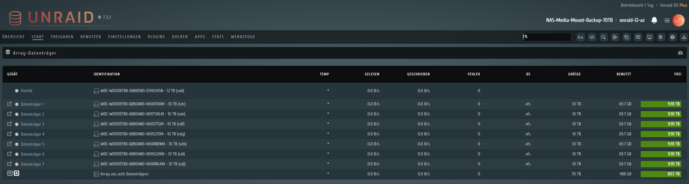
        </a>
      </td>
      <td width="27"></td>
      <td width="261" align="center" valign="middle">
        <a href="assets/screenshots/unraid-theme-02.png">
          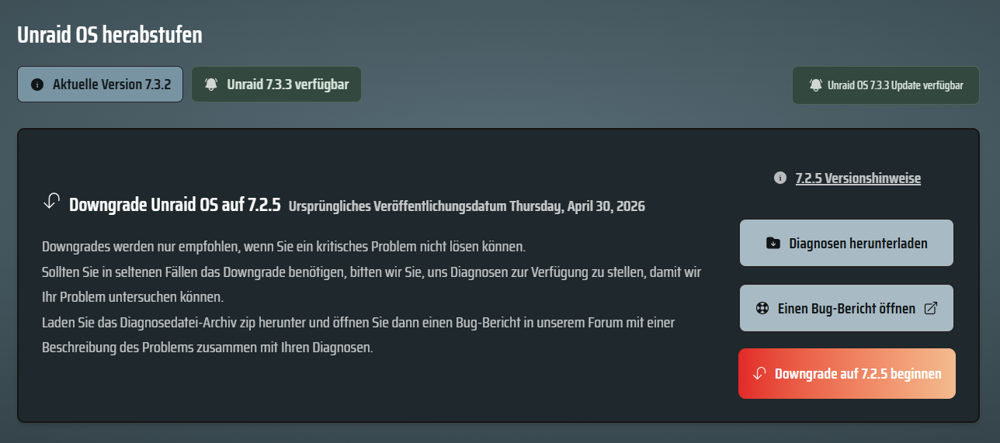
        </a>
      </td>
      <td width="27"></td>
      <td width="261" align="center" valign="middle">
        <a href="assets/screenshots/unraid-theme-03.png">
          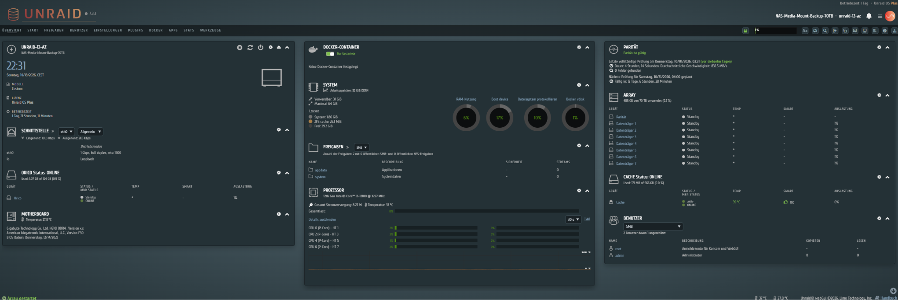
        </a>
      </td>
    </tr>
    <tr>
      <td width="261" align="center" valign="middle">
        <a href="assets/screenshots/unraid-theme-04.png">
          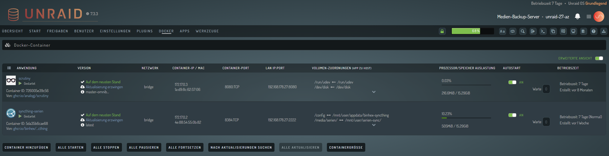
        </a>
      </td>
      <td width="27"></td>
      <td width="261" align="center" valign="middle">
        <a href="assets/screenshots/unraid-theme-05.png">
          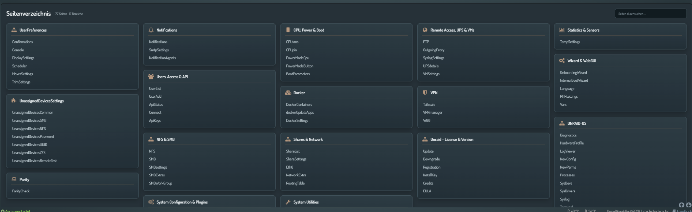
        </a>
      </td>
      <td width="27"></td>
      <td width="261" align="center" valign="middle">
        <a href="assets/screenshots/unraid-theme-06.png">
          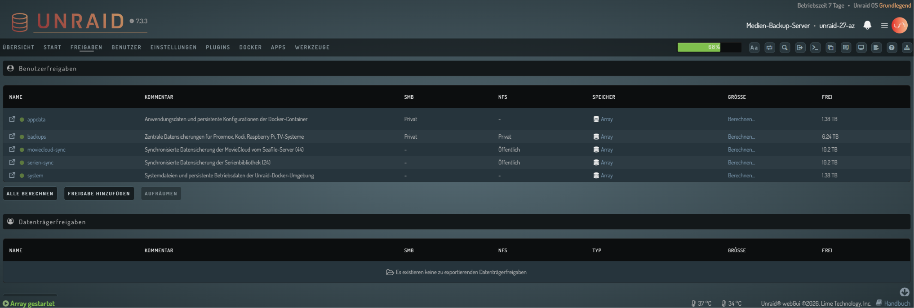
        </a>
      </td>
    </tr>
    <tr>
      <td width="261" align="center" valign="middle">
        <a href="assets/screenshots/unraid-theme-07.png">
          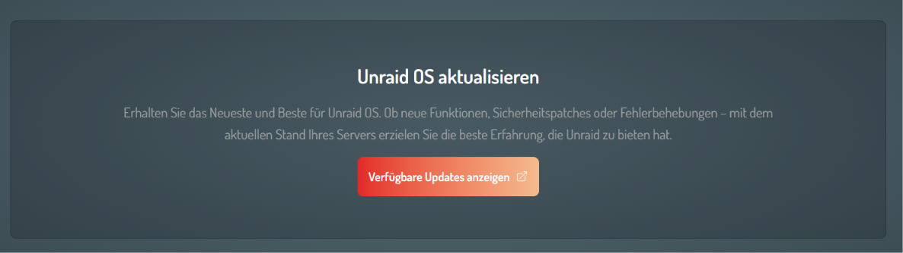
        </a>
      </td>
      <td width="27"></td>
      <td width="261" align="center" valign="middle">
        <a href="assets/screenshots/unraid-theme-08.png">
          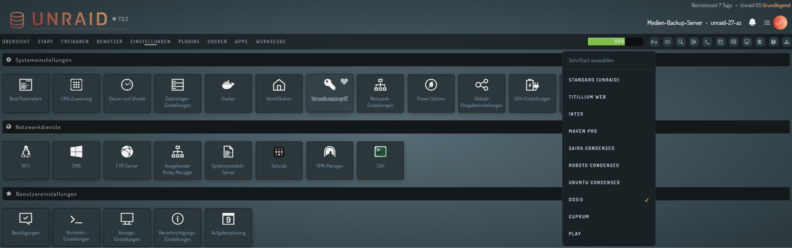
        </a>
      </td>
      <td width="27"></td>
      <td width="261" align="center" valign="middle">
        <a href="assets/screenshots/unraid-theme-09.png">
          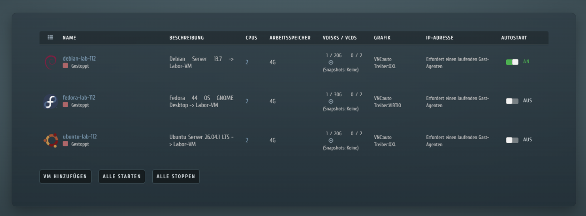
        </a>
      </td>
    </tr>
    <tr>
      <td width="261" align="center" valign="middle">
        <a href="assets/screenshots/unraid-theme-10.png">
          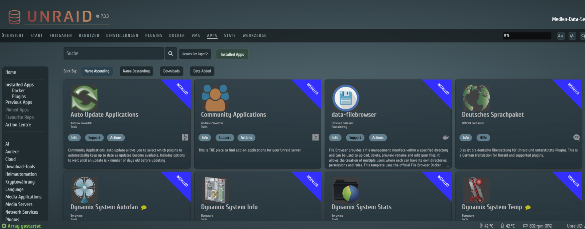
        </a>
      </td>
      <td width="27"></td>
      <td width="261" align="center" valign="middle">
        <a href="assets/screenshots/unraid-theme-11.png">
          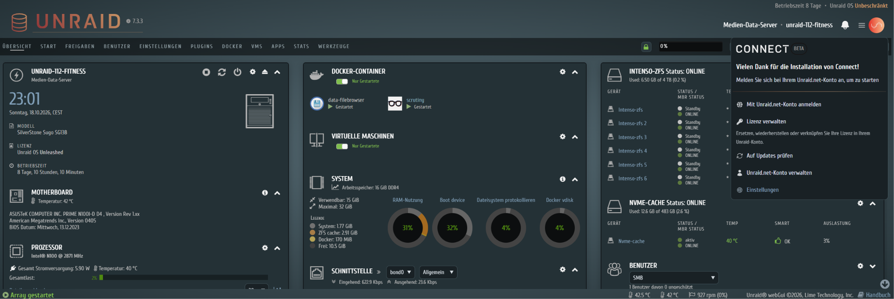
        </a>
      </td>
      <td width="27"></td>
      <td width="261" align="center" valign="middle">
        <a href="assets/screenshots/unraid-theme-12.png">
          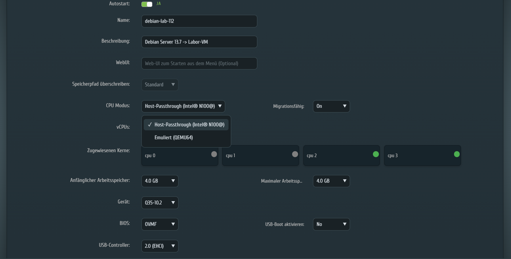
        </a>
      </td>
    </tr>
  </tbody>
</table>

---

## 📦 Installation

> [!IMPORTANT]
> Run the installer as **root** on your Unraid server.
> Back up your Unraid flash configuration before installation.

### Fresh installation

```bash
curl -fsSL https://raw.githubusercontent.com/topa-LE/unraid-dark-theme/main/scripts/bootstrap.sh | bash
```

The bootstrap downloads the current `main` branch and starts
the project installer.

### Installation language

The installer selects German messages for German locales and
English messages for other locales.

An explicit language can also be selected:

**English**

```bash
curl -fsSL https://raw.githubusercontent.com/topa-LE/unraid-dark-theme/main/scripts/bootstrap.sh | TOPA_LANG=en bash
```

**Deutsch**

```bash
curl -fsSL https://raw.githubusercontent.com/topa-LE/unraid-dark-theme/main/scripts/bootstrap.sh | TOPA_LANG=de bash
```

The language selection affects installer messages, not the
language configured in the Unraid WebGUI.

### Persistent installation

The theme is installed under:

```text
/boot/config/custom-css/topa-LE/
```

The installer adds a dedicated theme block to:

```text
/boot/config/go
```

At boot, the theme is reapplied through:

```bash
bash /boot/config/custom-css/topa-LE/scripts/apply.sh
```

The installation integrates the WebGUI stylesheet, supporting
JavaScript modules, custom login styling and the reboot/shutdown
page theme.

---

## 🔄 Updating

Run the installed updater as root:

```bash
bash /boot/config/custom-css/topa-LE/scripts/update.sh
```

The updater downloads the latest `main` branch and runs the
installer again.

Existing rollback state is retained where applicable.

---

## ↩️ Uninstall and Rollback

Run the uninstaller as root:

```bash
bash /boot/config/custom-css/topa-LE/scripts/uninstall.sh
```

The uninstaller removes the theme's boot and WebGUI hooks,
restores saved original configuration values where applicable,
and removes the managed theme directory.

It includes protection checks for original login and terminal
settings. Later manual changes to certain settings are preserved.

> [!WARNING]
> Complete automatic rollback after every possible installation
> failure is not guaranteed. Keep a backup of your Unraid flash
> configuration.

---

## 🖥️ WebTerminal Customization

The theme includes a custom dark terminal palette and
persistent terminal font settings.

<table width="100%">
  <thead>
    <tr>
      <th width="225">Setting</th>
      <th width="612">Theme configuration</th>
    </tr>
  </thead>
  <tbody>
    <tr>
      <td width="225">Background</td>
      <td width="612">Dark</td>
    </tr>
    <tr>
      <td width="225">Foreground</td>
      <td width="612">Light</td>
    </tr>
    <tr>
      <td width="225">Cursor</td>
      <td width="612">Warm accent</td>
    </tr>
    <tr>
      <td width="225">Font family</td>
      <td width="612">Cascadia Mono, Consolas, monospace</td>
    </tr>
    <tr>
      <td width="225">Font size</td>
      <td width="612">17</td>
    </tr>
    <tr>
      <td width="225">Line height</td>
      <td width="612">1.15</td>
    </tr>
  </tbody>
</table>

The original terminal configuration is retained for restoration
where applicable.

---

## 🧩 Repository Structure

The following tree shows the tracked project structure. Bundled font assets are summarized for readability.

```text
unraid-dark-theme/
├── css/
│   ├── base.css
│   ├── black-dark.css
│   ├── blue-dark.css
│   ├── boot.css
│   ├── font-switcher.css
│   ├── fonts.css
│   ├── gray-dark.css
│   ├── loader.css
│   ├── overrides.css
│   ├── pagemap.css
│   ├── theme-switcher.css
│   └── theme.css
├── docs/
│   ├── unraid-content-box.md
│   ├── unraid-popup-box.md
│   └── unraid-status-colors.md
├── fonts/
│   └── …
├── img/
│   └── topa-le-avatar-login.png
├── js/
│   ├── array-operation.js
│   ├── font-switcher.js
│   ├── language-switch-fix.js
│   ├── pagemap.js
│   ├── system-stats.js
│   └── theme-switcher.js
├── login/
│   └── login-theme.css
├── scripts/
│   ├── lib/
│   │   └── i18n.sh
│   ├── apply.sh
│   ├── bootstrap.sh
│   ├── install.sh
│   ├── uninstall.sh
│   └── update.sh
├── .gitignore
├── LICENSE
├── README.md
└── VERSION
```

### Technical documentation

- [Content boxes](docs/unraid-content-box.md)
- [Popup boxes](docs/unraid-popup-box.md)
- [Status colors](docs/unraid-status-colors.md)

---

## 🛡️ Compatibility

This theme modifies parts of the Unraid WebGUI and its runtime
integration. Unraid updates may change underlying markup or
styles and require compatibility adjustments.

The original project documentation records testing on Unraid
7.2.5, and the language-switch fix was tested on Unraid 7.3.2.

These observations are not a guarantee of compatibility with
every Unraid 7.x release.

---

## 🛠️ Development

Development is tracked through Git. Visual changes and
installer modifications are tested against real Unraid
installations before release.

The project keeps the theme source, installation scripts,
local fonts and supporting documentation in this repository.

---

## 📜 License

The original theme source code and project documentation are released under
the **[MIT License](LICENSE)**.

Copyright © 2026 topa-LE.

The bundled fonts are third-party assets and remain subject to their
respective license and copyright terms. Their license files are retained
in the corresponding subdirectories of [`fonts/`](fonts/).

Made with ❤️ by topa-LE · [⬆ Back to top](#-topa-le-unraid-dark-theme)
